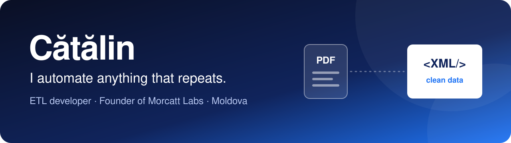

I started out fixing PCs. Today I turn messy documents into reliable data for international companies, and I build my own products at [Morcatt Labs](https://github.com/morcatt-labs).

## 💼 At work

**ETL Developer · 5+ years**

- **500+ PDF-to-XML extraction templates,** each one built around a client's documents
- **Many languages,** from German to Slavic languages and Chinese
- **ZUGFeRD and XRechnung** e-invoicing now, with past work across other formats including Peppol
- **Validation:** regex rules and Schematron, with every requirement checked against hundreds of pages of specifications in NotebookLM
- **Data:** extracted with SQL, analyzed with Python

## 🚀 What I build

**[Cattport](https://github.com/morcatt-labs/cattport)** puts Docker services and links right in the Synology DSM menu. Public beta, open source under GPLv3, in every language DSM supports plus Romanian.

## 🏠 Beyond work

I run my own home automation on Zigbee and self-host my services on my own server with Docker, including single sign-on (OIDC). I've also installed surveillance camera systems.

## 🧰 Tools

## 🛤️ How I got here

I earned my first money cleaning yards and washing cars and fences for wealthy families. Everything since, I taught myself or studied for.

- **🖥️ Hardware & networks:** PC repair, callback technician, surveillance camera installs
- **🎨 Design & print:** printing, logo design
- **🌐 Software:** WordPress sites, university apps, Cattport
- **📊 Data:** database administration and applied informatics (8 years of study), ETL development

## 🤝 Let's talk

I'm looking for roles where I can come up with product ideas, build applications and use AI to solve real problems. E-invoicing and document data are where my experience runs deepest.

📺 [morcatt.github.io](https://morcatt.github.io): the same story as a TV you can switch on 
📫 [catmoroshan@gmail.com](mailto:catmoroshan@gmail.com)
