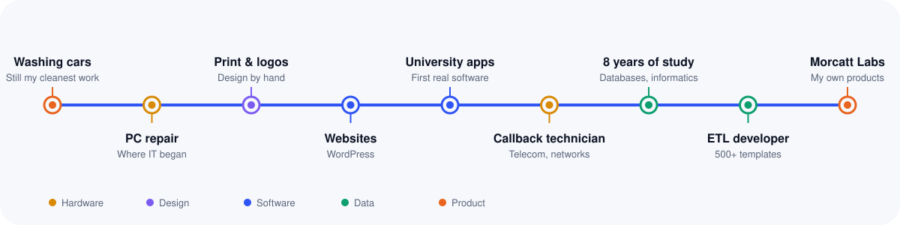

<picture><source media="(prefers-color-scheme: dark)" srcset="assets/header-dark.svg"></picture>

<a href="https://morcatt.github.io"><b>Website</b></a> · <a href="https://www.linkedin.com/in/morcatt/"><b>LinkedIn</b></a> · <a href="https://github.com/morcatt-labs"><b>Morcatt Labs</b></a> · <a href="mailto:catmoroshan@gmail.com"><b>Email</b></a>

Companies are full of work people repeat by hand: reading documents, answering the same questions, moving data between systems. I build the systems that take that work over, and my own products on the side.

> **Now:** Taking Cattport from public beta into the SynoCommunity package catalog.

## What I build

<table><tr><td width="50%" valign="top"><h3>⚙️ Automation &amp; data</h3>500+ extraction templates that turn documents in many languages into structured data, validated against international standards.</td><td width="50%" valign="top"><h3>🤖 AI integrations</h3>An AI chatbot for a national telecom operator, from website integration and dialogue flows to identifying customers.</td></tr><tr><td width="50%" valign="top"><h3>🚀 Products &amp; apps</h3>Cattport, an open-source package in public beta, plus websites and web services. Mobile apps are next.</td><td width="50%" valign="top"><h3>🛠️ Infrastructure</h3>Self-hosted services on my own server: Docker, single sign-on, secure remote access and backups.</td></tr></table>

## Selected work

<b>An AI assistant for a national telecom operator</b> · <i>During the pandemic</i>

- **Problem:** Customers kept asking the support team the same questions, at a time when everyone moved online.
- **What I did:** I integrated an AI chatbot platform into the operator's website, built the dialogue flows and connected it to customer identification, so it could recognise who is writing and offer real answers and solutions.
- **Result:** About 1,000 conversations in its first month, real customers and test runs together. It is still answering customers today, and it has never asked for a day off.

<b>Document data at scale</b> · <i>5+ years, ongoing</i>

- **Problem:** International companies receive invoices and business documents in every layout and language, and their systems need clean, standard-compliant data.
- **What I did:** I build extraction templates that read these documents and turn them into structured XML, then validate the result against EN 16931, ZUGFeRD and XRechnung rules with Schematron.
- **Result:** More than 500 templates in German, Slavic languages, Chinese and more.

<b>A product from idea to release, alone</b> · <i>2026</i>

- **Problem:** Synology users run many Docker services and keep their ports and links in bookmarks or in their heads.
- **What I did:** I designed and built Cattport, which puts those services right into the DSM main menu, with packaging, translations and documentation.
- **Result:** Public beta, open source under GPLv3, and submitted to the SynoCommunity package catalog.

## Projects

Every project sits on its stage and moves right as it grows.

<picture><source media="(prefers-color-scheme: dark)" srcset="assets/pipeline-dark.svg"></picture>

- **[Cattport](https://github.com/morcatt-labs/cattport)**: Docker services and links in the Synology DSM menu · *beta*
- **[Cătălin TV](https://morcatt.github.io)**: A personal site you switch on like a TV · *live*

**[Cattport](https://github.com/morcatt-labs/cattport)** · Docker services and links in the Synology DSM menu. Latest release **v1.0.0-beta.3** · GPL-3.0

## Toolbox

<picture><source media="(prefers-color-scheme: dark)" srcset="assets/toolbox-dark.svg"></picture>

<b>All 57 tools</b> (bold = every week)

| Area | Tools |
|---|---|
| Data & cloud | **SQL** · **Python** · **Google Cloud** · **BigQuery** · **Cloud SQL** · PostgreSQL · MySQL · SQL Server · Oracle · pandas |
| Documents & e-invoicing | **PDF** · **XML** · **ZUGFeRD** · **EN 16931** · **XRechnung** · **Schematron** · **Regex** · Factur-X · Peppol · UBL · CII · XSD · EDIFACT · OCR · DataStage TX-style mapping |
| Code | **Python** · **Bash** · C# · Java · JavaScript · HTML & CSS · React · Node.js · Flask |
| Infrastructure & networks | **Docker** · Linux · Git · Reverse proxy · OIDC / SSO · Cloudflare · WireGuard · LAN & Wi-Fi · IP camera systems |
| AI | **ChatGPT** · **Claude** · **Gemini** · **NotebookLM** · Ollama · LLM APIs · Chatbot platforms |
| Design & media | **Photoshop** · **Illustrator** · InDesign · Figma · Premiere Pro · After Effects · DaVinci Resolve |

## Path

<picture><source media="(prefers-color-scheme: dark)" srcset="assets/path-dark.svg"></picture>

<b>How I work</b>

- **Validate against the spec, not the sample.** One invoice that looks right proves nothing; the standard decides.
- **Automate the second time.** If I do something twice by hand, the third time is a script. The fourth time, I forget the script exists and write a better one.
- **Ship, then sharpen.** A public beta with real users teaches more than a perfect plan.

## Let's talk

Got a problem that looks too complicated, or too boring, to automate? Write to me. Boring is my favourite. I'm open to roles where I can shape product ideas, build applications and use AI on real problems, anywhere in the world.

🗣️ Romanian · English · German for business and finance terms, learning the rest

<a href="https://morcatt.github.io"><b>Website</b></a> · <a href="https://www.linkedin.com/in/morcatt/"><b>LinkedIn</b></a> · <a href="https://github.com/morcatt-labs"><b>Morcatt Labs</b></a> · <a href="mailto:catmoroshan@gmail.com"><b>Email</b></a>

This profile builds itself from <a href="profile.yml">profile.yml</a>.
